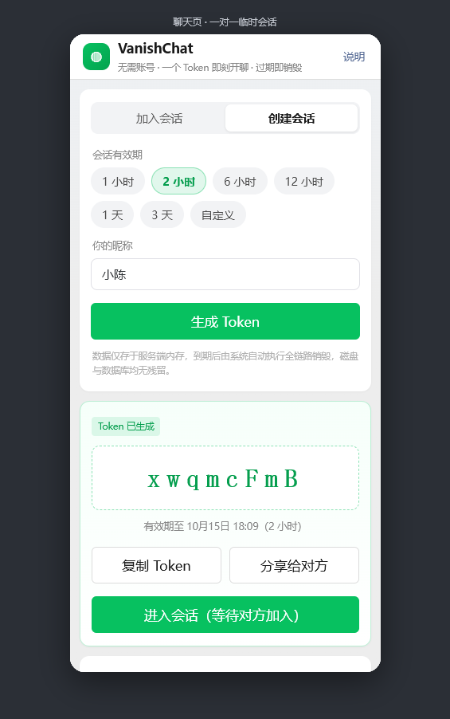
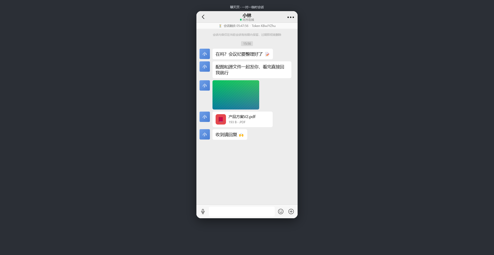
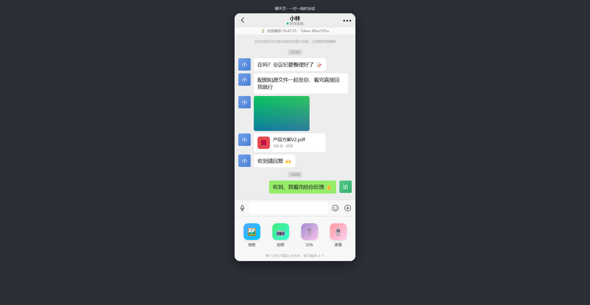
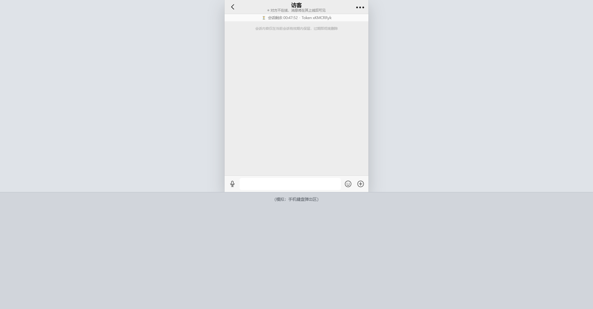

# VanishChat · Token 制临时聊天 SaaS

> 无账号、凭 Token 匹配、会话级临时存储、退出即销毁。
> 移动端优先，1:1 对齐微信的视觉与触感；全程仅内存存储，会话终结即物理删除。

---

## 1. 它解决什么问题

| 场景 | 传统 IM | VanishChat |
| --- | --- | --- |
| 建立联系 | 双方都要注册、加好友 | 一方生成 8 位 Token，另一方输入即连 |
| 数据留存 | 服务端永久落库 | 仅内存持有，到期批量抹除 |
| 文件残留 | 对象存储长期保存 | 按 Token 分目录，会话销毁即递归删除 |
| 隐私顾虑 | 无法证明"没留底" | 无磁盘持久化，销毁链路可验证（见 §6） |

## 2. 架构

```
                    ┌─────────────────────────────┐
   浏览器（移动优先） │  Vue 3 + Vite + Naive UI     │
   · 类微信聊天界面   │  Socket.io-client（断线重连） │
   · 软键盘 / 刘海屏  └──────────┬──────────────────┘
   · 拍照 / 相册 / 文件           │  HTTP(文件) + WebSocket(信令)
                                 ▼
                    ┌─────────────────────────────┐
                    │  Nginx 接入层                │
                    │  反向代理 / WS 协议升级 / 压缩 │
                    └──────────┬──────────────────┘
                               ▼
                    ┌─────────────────────────────┐
                    │  Node.js + Express + Socket.io│
                    │  · 会话服务（创建/校验/销毁）   │
                    │  · 消息服务（校验/入册/广播）   │
                    │  · 文件服务（暂存→会话目录）    │
                    │  · 清扫器（过期全链路销毁）     │
                    │  · 行为日志（独立保留周期）     │
                    └──────────┬──────────────────┘
                               ▼
        ┌──────────────────────┴──────────────────────┐
        ▼                                             ▼
┌────────────────┐                        ┌────────────────────┐
│ Redis 7.x      │  仅内存，关闭 RDB/AOF   │ storage/uploads/   │
│ 会话/消息/文件元数据 │  TTL 自动过期          │ <token>/<fileId>   │
│ 行为日志(独立TTL) │                        │ 会话销毁即递归删除   │
└────────────────┘                        └────────────────────┘
```

**存储驱动可插拔**：`STORE_DRIVER=redis | memory | auto`。
`auto`（默认）会先尝试 Redis，连不上自动降级为进程内存并打印告警 —— 没有 Redis 也能一条命令跑起来。

## 3. 界面预览

| 首页 · 创建会话 | 聊天页 · 一对一 | 聊天页 · 更多面板 |
| --- | --- | --- |
|  |  |  |

左侧灰绿气泡为对方消息、右侧微信绿为本方消息，含时间分隔、图片按原比例渲染、
文件卡片、有效期倒计时、在线状态点与「+」号多功能面板。

## 4. 快速开始
```bash
# 1) 安装依赖（npm workspaces，一次装齐 server + web）
npm install

# 2) 启动服务端（默认 http://localhost:3000）
npm start

# 3) 另开终端启动前端开发服务器（http://localhost:5173，已配好 /api 与 /socket.io 代理）
npm run dev:web
```

生产模式（单端口托管前端产物 + API）：

```bash
npm run build:web   # 产出 web/dist
npm start           # 服务端自动托管 dist，访问 http://localhost:3000
```

Docker 一键部署（Redis + App + Nginx）：

```bash
docker compose up -d --build
# 打开 http://localhost
```

> 上传目录在 compose 中挂载为 **tmpfs**，物理层同样只有内存，容器重启即清空。

### 4.1 手机真机联调（ChmlFrp 内网穿透）

移动端聊天必须用真机测键盘、刘海屏和拍照，本机 `localhost` 手机访问不到，用 ChmlFrp 把 3000 端口映射到公网：

```bash
npm start                 # 先确保服务端在跑
npm run tunnel -- --download   # 首次：自动下载客户端并启动隧道
npm run tunnel                 # 之后直接启动
npm run tunnel:check           # 只体检：客户端 / 本地服务 / 公网可达性
```

启动后终端会算出外网地址（当前节点：`http://82.156.215.91:24386`），手机浏览器直接打开即可。

换节点时改 `frpc.ini` 里三处即可：`server_addr`、`[隧道名]`、`remote_port`（都要与面板一致）。

配置文件在 `deploy/frpc/<客户端目录>/frpc.ini`，模板见 `deploy/frpc/frpc.ini.example`
（`user` 填面板的账号 ID，`token` 固定为 `ChmlFrpToken`，`remote_port` 必须与面板隧道的「外网端口」一致）。

已验证：通过隧道访问时 `/api/health`、WebSocket 长连接、文件上传下载全部正常，
`E2E_BASE=http://<节点IP>:<外网端口> npm run e2e` 同样 **35/35 通过**。

> ⚠️ **两个必须知道的限制**
> 1. **录音不可用**：`getUserMedia` 要求安全上下文，`http://IP:端口` 不是安全上下文，麦克风会被浏览器直接拒绝（前端已给出友好提示）。要测语音，需换成 HTTPS 域名或在本机 `localhost` 上测。
> 2. **境内节点 + 网页服务**：ChmlFrp 官方提示境内节点映射网页服务需绑定已备案域名。当前用 IP 直连实测可用，但长期稳定建议配自有域名 + HTTPS。
>
> 免费版带宽限制 8Mbps，日常文字/图片够用，传大视频会明显慢。

## 5. 目录结构

```
VanishChat/
├─ server/src/
│  ├─ config.js              全部可调参数（有效期档位、文件上限、日志周期…）
│  ├─ app.js                 Express 装配 + 前端产物托管 + SPA fallback
│  ├─ index.js               启动编排：存储 → 服务 → 清扫器 → HTTP/WS
│  ├─ events.js              进程内事件总线（销毁事件解耦广播）
│  ├─ store/
│  │  ├─ index.js            存储工厂（redis / memory / auto 降级）
│  │  ├─ memoryStore.js      进程内存实现，零依赖
│  │  └─ redisStore.js       Redis 7.x 实现，Key 设计见文件头注释
│  ├─ services/
│  │  ├─ sessionService.js   创建 / 校验 / 加入 / 续期 / 全链路销毁
│  │  ├─ messageService.js   消息校验与入册（服务端重签 id/seq/ts）
│  │  ├─ fileService.js      暂存→会话目录、Range 读取、递归删除、孤儿回收
│  │  ├─ sweeper.js          过期扫描 → 销毁 → 孤儿目录 GC
│  │  └─ logService.js       行为日志（强制剥离消息正文字段）
│  ├─ socket/index.js        Socket.io 房间 / 广播 / 重连 / 限流
│  ├─ routes/                session / media / system 三组 HTTP 接口
│  └─ middleware/            限流、统一错误处理
├─ web/src/
│  ├─ composables/useChat.js      连接、房间、消息合并、localId 对齐
│  ├─ composables/useViewport.js  visualViewport 软键盘适配（高度 + 平移）
│  ├─ composables/useUpload.js    XHR 进度上传 + 媒体探测
│  ├─ components/                 NavBar / MessageList / MessageItem / ChatInput / PlusPanel / EmojiPanel / MediaViewer
│  │                              + ViewportDebug（?debug=1 时的视口读数浮层）
│  └─ views/                      HomeView / ChatView / AboutView
├─ scripts/
│  ├─ e2e.mjs                端到端验收（35 项断言）
│  ├─ tunnel.mjs             ChmlFrp 内网穿透启动器（真机联调用）
│  ├─ seed-demo.mjs          演示数据播种（含中文文件名、图片、PDF）
│  └─ lib/png.mjs            零依赖 PNG 生成器（供播种脚本造图）
├─ deploy/
│  ├─ nginx.conf             WebSocket 升级 + 不缓存
│  └─ frpc/frpc.ini.example  ChmlFrp 客户端配置模板
└─ Dockerfile / docker-compose.yml
```

## 6. 核心机制

### 6.1 Token 生成

- 字符集 `A-Z a-z 0-9` 中**剔除 `0 O o 1 I l`**，剩 56 个字符，8 位空间约 9.7×10¹³
- 用 `crypto.randomInt` 级别随机源，创建时查重、最多重试 8 次
- 配合两层防护：`/api/session/:token/verify` 单 IP 30 次/分钟限流 + `expireAt` 硬过期

### 6.2 有效期与"重连不丢数据"

- 档位：`1 / 2 / 6 / 12 / 24 / 72` 小时，亦可自定义（上限 `SESSION_MAX_TTL_HOURS`）
- 到期时间是**绝对时间**（创建时确定），心跳只更新 `lastSeenAt`，不会变相延长会话
- 参与者身份存于 `sessionStorage`（关标签页即消失，符合"临时"基调），重连时带上 `participantId` 复用原席位，因此刷新 / 熄屏 / 切后台回来都能拿回完整历史
- 席位分配：命中 `participantId` → 复用；有空位 → 新席位；满员且有离线成员 → 顶替离线最久的席位；否则拒绝。这样既不会被"离线占位"锁死，也不会让新访客冒用他人身份

### 6.3 多媒体：HTTP 上传 + WebSocket 信令

```
选文件 → 本地探测(宽高/时长) → 插入本地占位气泡(带进度环)
      → XHR POST /api/upload (token 绑定, 进度回调)
      → WS msg:send { type, file:{id} }
      → 服务端校验 fileId 归属本会话 → 广播 msg:new
      → 前端按 localId 把占位气泡替换为服务端消息
```

- 支持文本 / 图片 / 视频 / 语音 / 任意文件；语音用 `MediaRecorder` 长按录制
- 富媒体消息的 `fileId` 必须属于当前会话，**跨会话引用会被拒绝**
- 上传并发度 3，弱网下兼顾速度与成功率；失败可一键重发（保留原始 File 对象）
- 文件读取支持 `Range`，视频可拖拽；`Cache-Control: no-store`

### 6.4 移动端三大痛点

| 痛点 | 实现 |
| --- | --- |
| 软键盘遮挡 | `visualViewport` 实时换算可视高度写入 `--app-height`，整个应用外壳跟着键盘收缩；键盘开合自动滚到底部；输入框字号 ≥16px 避免 iOS 聚焦放大（细节见下方"键盘留白"） |
| 刘海屏 | `env(safe-area-inset-*)` 贯穿导航栏 / 输入栏 / 面板 / 预览层，横竖屏切换实时重算 |
| 触控体验 | `touch-action: manipulation` 禁双击缩放、去点击高亮、`-webkit-overflow-scrolling: touch` 原生阻尼、`overscroll-behavior: contain` 防穿透、图片按真实比例渲染避免跳动 |

#### 键盘留白（Chromium iOS 的坑）

真机（iPhone + Chrome iOS）反馈过「打字时输入框浮在屏幕上半部，下方一大片空白」。根因是**不能只信 `visualViewport.height`**：
键盘弹出时该值会缩到几十像素（实测 390×844 机型只剩 80px 左右），而真正可视区还有 300 多像素；外壳被压扁后输入框自然"浮"走了，同时 iOS 又把整页平移了一把，于是下面露出空白。

现在的取值策略（`web/src/composables/useViewport.js`）：

1. `--app-height` 取 `visualViewport.height`，但该值小到不合常理（< 140px 且不足 `innerHeight` 的 30%）时判为不可信，退回 `innerHeight`；
2. 浏览器自己缩小了布局视口（`innerHeight` 明显变小，如 `interactive-widget=resizes-content`、Chrome iOS）时，两者都可信就取较大值——宁可算高，绝不被一个偏小的数字压成一条；
3. `--kb-offset` 跟随可视视口的平移量（iOS 系），保证外壳始终贴在真正看得见的那块区域上，且只在外壳高度确实等于可视区高度时才跟随；
4. `html/body` 不再写 `height: 100%`，文档高度跟随外壳，浏览器无从把页面平移到外壳之外。

真机排查：地址后面加 `?debug=1`（如 `http://<公网地址>/#/chat/XXXXXXXX?debug=1`），右上角会浮出实时读数（innerHeight / visualViewport / 基准值 / 实际写入值），一眼能看出走的是哪条分支。

修复后（下方灰块模拟手机键盘占位，输入栏紧贴键盘、无留白）：



## 7. 销毁链路（可验证）

```
触发条件：到期（清扫器） / 任一方主动结束
  1. 存储层 destroySession()
       Redis：SCAN 匹配 vc:s:<token>* 全量 DEL + ZREM 索引
       内存：删除会话 / 参与者 / 消息 / 文件四张表
  2. fileService.purgeSessionFiles()
       递归删除 storage/uploads/<token>/ 整个目录
  3. 事件总线 → 广播 session:destroyed → 房间内所有连接被踢出
  4. 写一条行为日志（action / token / 原因 / 删除计数，不含任何消息内容）
```

双保险：

- **Redis TTL**：所有会话 Key 都设了 `PEXPIREAT = expireAt`，即便服务进程不在，数据也会被 Redis 自身清掉
- **孤儿目录 GC**：每 10 轮清扫比对 `storage/uploads/` 与会话索引，删除任何无主目录
- **索引宽限期**：Token 索引 ZSET 多活 24h，保证进程重启后仍能发现"过期但文件未删"的会话并补删

验收脚本已断言：销毁后 `GET /api/file/...` 返回 404、`verify` 返回 404、重复销毁幂等。

## 8. 接口与事件契约

### HTTP

| 方法 | 路径 | 说明 |
| --- | --- | --- |
| GET | `/api/session/config` | 档位、文件上限、存储驱动等前端配置 |
| POST | `/api/session/create` | 创建会话，返回 8 位 Token（10 次/分钟/IP） |
| GET | `/api/session/:token/verify` | 校验 Token，返回剩余时间与在线人数（30 次/分钟/IP） |
| GET | `/api/session/:token/messages` | 拉取历史消息（仅内存） |
| POST | `/api/session/:token/destroy` | 立即销毁，幂等 |
| POST | `/api/upload` | 上传文件（multipart，字段名 `file`） |
| GET | `/api/file/:token/:fileId` | 读取文件，支持 Range |
| DELETE | `/api/upload/:token/:fileId` | 取消上传 / 删除单个文件 |
| GET | `/api/health` | 健康检查与运行指标 |
| GET | `/api/logs?date=` | 行为日志（需 `x-admin-token`，仅行为不含内容） |

### WebSocket

| 方向 | 事件 | 载荷 |
| --- | --- | --- |
| C→S | `session:join` | `{ token, participantId?, name? }`，ack 返回会话快照 + 历史消息 |
| C→S | `msg:send` | `{ type, content?, file?, localId? }` |
| C→S | `msg:read` | `{ upToTs }` |
| C→S | `typing` | `{ typing }` |
| C→S | `session:leave` / `session:destroy` / `presence:ping` | — |
| S→C | `session:ready` | 由 `session:join` 的 ack 返回 |
| S→C | `msg:new` / `msg:read` / `typing` / `presence:update` / `session:tick` / `session:destroyed` | 见 `server/src/socket/index.js` 注释 |

所有消息的 `id / seq / ts` 均由服务端重新生成，不信任客户端时间戳。

## 9. 运行与验收

```bash
npm run e2e                                  # 35 项端到端断言
node scripts/seed-demo.mjs <token> --hold    # 造演示数据并驻留为"对方"
```

最近一次执行结果：**35 / 35 通过**，覆盖创建、校验、限流拒绝、双端加入、
双向消息、输入状态、已读回执、上传与类型识别、中文文件名往返、断线重连、
席位隔离、满员拒绝、主动销毁、销毁后文件与 Token 双双失效、接口幂等。

## 10. 生产注意事项

1. **Redis 必须关闭持久化**：`--save "" --appendonly no`，否则数据会落盘
2. **上传目录建议挂 tmpfs**，或使用独立临时盘并在销毁时确认删除
3. **多实例扩容**：Socket.io 已内置 Redis 适配器，无需粘性会话；`deploy/nginx.conf` 的 upstream 追加实例即可
4. **多实例下的销毁广播**：每个实例的清扫器都会发现同一过期会话并各自向本实例房间广播，`destroy` 幂等；如需绝对单点触发，可把清扫器收敛为独立进程
5. **HTTPS**：录音（`getUserMedia`）与剪贴板 API 要求安全上下文，生产必须启用 TLS
6. `ADMIN_TOKEN` 未设置时 `/api/logs` 直接 403，避免日志接口裸奔
7. **内存水位**：单会话消息条数（`SESSION_MAX_MESSAGES`）与上传统计需按业务规模调整；Redis 侧建议设置 `maxmemory-policy allkeys-lru`（compose 已内置）

## 11. 已知边界

- 单会话默认上限 2 人（`SESSION_MAX_PARTICIPANTS`），改为更大值即可支持小群聊，界面无需调整
- 内存驱动为单进程模型，多实例部署请使用 Redis 驱动
- 消息历史单次最多返回 500 条，更早历史需按 `before` 参数分页拉取
- 未做端到端加密：服务端在会话有效期内可读消息明文（如需端到端加密，应在客户端用 Token 派生密钥做 ECDH + AES-GCM）
